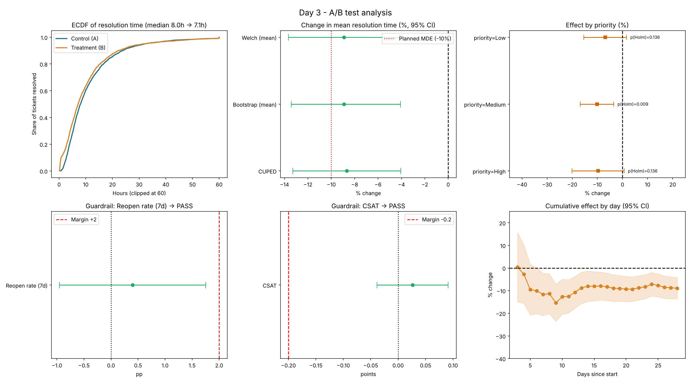

# تقييم أثر المساعد الذكي (AI Bot) على زمن حل التذاكر في الدعم الفني

## اسم الدورة
**التجارب واختبارات A/B والاستدلال السببي (A/B Testing and Causal Inference)** — إشراف وتدريب: [أكاديمية سدايا (SDAIA Academy)](https://github.com/SDAIAAcademy)

**المتدربة:** الجوهره فهد بن عيد

> **تنبيه:** جميع البيانات في هذا المشروع **بيانات محاكاة (Simulated)** يولّدها الكود (`simulation.py`) لأغراض التدريب، وليست بيانات جهة حقيقية. افتراضات المحاكاة مكتوبة في قاموس `CONFIG` داخل `simulation.py`.

## وصف المشكلة والهدف
يهدف هذا المشروع إلى قياس أثر تقديم المساعد الذكي (AI Bot) كخيار أول لحل مشكلات الدعم الفني قبل تحويل المستخدمين للدعم البشري، والتحقق مما إذا كان يساهم في تقليل متوسط زمن حل التذكرة مقارنة بالتحويل المباشر.
**القرار المطلوب:** هل نعتمد المساعد الذكي كخيار أول، ولأي أنواع التذاكر؟

## الفرضية وتصميم التجربة
- **السؤال الرئيسي:** هل يؤدي اعتماد المساعد الذكي كخيار أول إلى تقليل الوقت المستغرق لحل التذاكر؟
- **الفرضية:** تقديم المساعد الذكي يقلل زمن الحل من خلال التعامل الفوري مع الاستفسارات الشائعة وتقليل الضغط على ممثلي الدعم البشري.
- **المجموعة المعالجة (B):** التوجيه الأول للمساعد الذكي، ثم التصعيد للموظف إن لم يحل المشكلة.
- **المجموعة المقارنة (A):** التحويل المباشر للدعم البشري.

| العنصر | القيمة |
|---|---|
| وحدة العشوائية | التذكرة (توزيع عشوائي 50/50)، مع أخطاء معيارية عنقودية حسب الموظف |
| المقياس الرئيسي | متوسط زمن حل التذكرة (ساعات) |
| مقياس ثانوي | زمن أول رد (دقائق) |
| مقاييس الحماية | نسبة إعادة فتح التذكرة خلال 7 أيام (هامش +2 نقطة)، رضا العملاء CSAT (هامش -0.20) |
| α / القوة | 0.05 / 0.80 |
| أصغر أثر قابل للاكتشاف | تقليل 10% في متوسط الزمن (≈1.15 ساعة) |
| حجم العينة | 1,598 تذكرة/مجموعة للمقياس الرئيسي، و**3,053** لمقياس إعادة الفتح (الأكبر هو المعتمد) |
| المدة | 28 يوماً (250 تذكرة يومياً، أربعة أسابيع كاملة) |

## هيكل المشروع (ملف لكل يوم من أيام الدورة)
```
SDAIA_Athkax_AI_Support_AB_Test/
│
├── README.md
├── main.py                              (يشغّل الأيام الأربعة بالترتيب)
├── requirements.txt
├── simulation.py                        (CONFIG + simulate_experiment + srm_check)
├── utils.py                             (دوال إحصائية مشتركة)
├── day1_experiment_design.py            (السؤال، المقاييس، حجم العينة)
├── day2_data_and_quality_checks.py      (البيانات، التكرار، المفقود، SRM، التوازن)
├── day3_ab_analysis.py                  (Welch، Bootstrap، CUPED، Holm، مقاييس الحماية)
├── day4_causal_robustness_decision.py   (DAG، انحدار عنقودي، الأثر حسب النوع، الحساسية، القرار)
│
├── data/
│   ├── dataset.csv                      (البيانات الخام فيها عيوب مقصودة)
│   └── dataset_clean.csv
└── outputs/
    ├── charts/
    └── results/
```

## خطوات التشغيل
```bash
pip install -r requirements.txt
python main.py
```
أو تشغيل الملفات بالترتيب: `day1` ثم `day2` ثم `day3` ثم `day4`. المخرجات في `data/` و`outputs/charts/` و`outputs/results/`.

## البيانات وفحوص الجودة
- 28 يوماً × 250 تذكرة = 7,000 تذكرة، مع أربعة أنواع (حسابات، برمجيات، شبكات، عتاد) وثلاث أولويات و40 موظفاً.
- أُدخلت عيوب مقصودة: 15 سجلاً مكرراً و12 فئة مفقودة، وعُولجت في اليوم الثاني. رضا العملاء متوفر لنحو 40% فقط.
- **SRM:** سليم (A = 3,565، B = 3,435، p = 0.12). وفي عرض توضيحي لفقدان 5% من تذاكر B ظهر SRM بوضوح (p = 0.0002).
- توازن المتغيرات سليم (الفروق المعيارية أقل من 0.1). نوع التذكرة أعطى p = 0.043 وهذا متوقع بالصدفة عند إجراء عدة فحوص.

## المنهجية
اختبار Welch على المتوسط مع Bootstrap وMann-Whitney، وCUPED، وانحدار معدّل بأخطاء معيارية عنقودية حسب الموظف، واختبار تفاعل (Wald) وتصحيح Holm، وتحليلات حساسية (حذف المتطرفات، حذف الأسبوع الأول، تحليل على مستوى الموظف، اختبار التبديل العشوائي)، وفحص تأثير الجِدّة، ومخطط سببي DAG.

## أهم النتائج

> الأرقام الدقيقة في `outputs/results/`.

- **متوسط زمن الحل:** انخفض من 11.54 إلى 10.51 ساعة، أي **-8.9%** (CI 95%: من -13.7% إلى -4.2%، p < 0.001). الوسيط انخفض من 8.01 إلى 7.11 ساعة.
- **متانة النتيجة:** Bootstrap (-8.9%)، CUPED (-8.7%)، انحدار معدّل (-7.5%)، مستوى الموظف (-8.5%)، واختبار التبديل (p = 0.0015). كلها متسقة.
- **الأهمية الإحصائية والتجارية:** الأثر مؤكد إحصائياً، لكن الحد الأضعف في فترة الثقة (-4.2%) أقل من أصغر أثر مخطط (10%)، فحجمه الدقيق غير محسوم.
- **الأثر يختلف حسب نوع التذكرة** (اختبار التفاعل p < 0.001): الحسابات -18.5% والبرمجيات -13.5% (دالّان)، والشبكات -10.2% (غير دال بعد Holm)، أما **العتاد فارتفع زمنه +9.6%** (p بعد Holm = 0.02)، حيث حل المساعد 1% فقط من تذاكره وأضاف تأخيراً قبل التصعيد.
- **سبب الأثر:** المساعد حلّ 10.9% من تذاكر B بنفسه، وصُعِّد 89.1%.
- **مقاييس الحماية:** إعادة الفتح PASS (+0.40 نقطة، والحد الأعلى 1.75 مقابل هامش 2)، وCSAT PASS (+0.03).
- **زمن أول رد:** انخفض بنحو 97% لأن المساعد يرد فوراً.
- **الجِدّة:** لا نمط واضح لتلاشي الأثر عبر الأسابيع الأربعة.

## التوصية النهائية
**إطلاق المساعد الذكي لتذاكر الحسابات والبرمجيات، وإعادة تقييم الشبكات، واستثناء تذاكر العتاد** لظهور ارتفاع في زمن حلها. الأثر الإيجابي ثابت بعدة طرق ومقاييس الحماية سليمة، لكن الفائدة محصورة في أنواع بعينها.

## القيود والافتراضات
- البيانات محاكاة، والنتائج تعتمد على افتراضات المحاكاة ولا تُعمَّم على جهة حقيقية.
- تحليل الأنواع استكشافي ولم تُصمَّم التجربة لقوة كل نوع؛ نتيجة العتاد تحتاج تأكيداً بتجربة مخصصة.
- التوزيع على مستوى التذكرة قد يسبب تلوثاً إذا طبّق الموظف ما يتعلمه من المساعد على تذاكر المقارنة (يميل لتقليل الأثر المقدَّر).
- رضا العملاء متوفر لنحو 40% من التذاكر فقط (احتمال انحياز الاستجابة).
- مقياس اللوغاريتم (-26.6%) أكبر من المتوسط الخام لأن التذاكر التي يحلها المساعد سريعة جداً؛ لذلك اعتُمد المتوسط الخام مقياساً رئيسياً.
- الأثر التجاري في `final_recommendation.md` توضيحي فقط.
- الرسوم بالإنجليزية لتجنب مشكلات عرض العربية في matplotlib.

*الدورة: التجارب واختبارات A/B والاستدلال السببي — أكاديمية سدايا: https://github.com/SDAIAAcademy*
